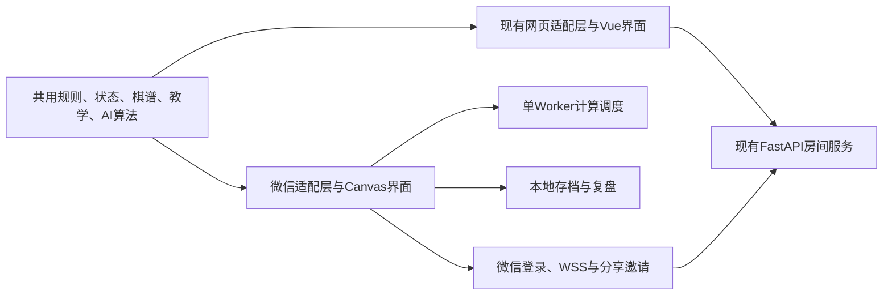

# LIFELINE 微信小游戏迁移计划

制定日期：2026-10-13（北京时间）  
状态：`PLANNED_NOT_IMPLEMENTED`  
目标：个人开发者注册，先交付完整核心玩法，再补齐网页高级功能。  
本次范围：核对当前源码、已有发布收据和微信官方文档，制定可执行计划；未实施迁移，未复跑游戏测试，未完成微信实机或账号后台核验。

## 1. 推荐路线与交付目标

采用 **微信小游戏 + 原生 JavaScript/Canvas 2D + 微信平台适配层**。复用现有 JavaScript 规则和算法，重新组织手机界面，联机继续使用现有 Python/FastAPI 服务。

对玩家而言，仍然是在微信里搜索、分享、点开即玩的产品；开发和发布按“小游戏”项目办理。当前游戏以棋盘对战为核心，小游戏路线更匹配其交互和传播方式。普通小程序适合以后独立承载资料或社区，不作为本次游戏客户端的主路线。

本方案不采用网页套壳：微信官方 `web-view` 文档当前明确个人类型小程序不支持该组件。小游戏运行环境也没有网页的 DOM/BOM，现有 Vue 页面、HTML 和 CSS 不能直接搬入。依据：[web-view](https://developers.weixin.qq.com/miniprogram/dev/component/web-view.html)、[小游戏 Adapter](https://developers.weixin.qq.com/minigame/dev/guide/runtime/adapter.html)。

首轮交付两个节点：

1. **内部可玩版 v0.1**：在真实微信客户端完成“进入 → 教学 → 人机/同机双人 → 结算 → 退出恢复 → 基础复盘”。
2. **核心公开版 v1.0**：加入两人好友房间、微信分享邀请、登录与重连，完成设备验收和平台要求后提审。

预计内部可玩版约 **7–11 个开发工作日**；核心公开版约 **18–27 个开发工作日，排期按 4–6 周**。估算基于一名熟悉仓库的开发者持续推进、能够及时使用安卓/iPhone 和微信账号，不含备案、资质办理、审核等待或重大性能问题。M1 原型结束后重估。

## 2. 当前基础与迁移难点

### 2.1 本次核对的项目事实

| 已有基础 | 证据入口 | 对迁移的意义 |
| --- | --- | --- |
| Vue 页面 + Canvas 2D；本地与联机共享规则引擎 | `web/WEB前后端需求与架构说明.md`、`main.js`、`OnlineApp.js`、`Renderer.js` | 游戏逻辑可复用，页面层需要另做 |
| 产品默认 `territory-v2`；引擎裸构造仍默认 v1 | `GameEngine.js`、`OnlineAppState.js` | 微信新局必须显式传入 v2，不修改旧规则默认值 |
| 规则支持 2/3 人、边长 5–15；现有产品 AI 用于双人 | `OnlineAppState.js`、`LocalAIModes.js`、`LocalPlayerSetup.js` | 首版聚焦双人；三人是后续产品适配，不重写规则 |
| 已有本地存档、版本化棋谱、五关教学及异步请求校验 | `LocalGameSession.js`、`ReplayCodec.js`、`TutorialRunner.js`、`AIStateProtocol.js` | 可复用数据契约和场景，替换存储、哈希、交互入口 |
| Canvas 使用 HTMLCanvasElement、DOM 多层画布、CSS 尺寸及 ResizeObserver | `Renderer.js`、`GameController.js` | 需拆开绘图算法和浏览器布局/事件代码 |
| AI、提示、精确领土各有浏览器 Worker 生命周期 | `AIWorker.js`、`HintWorkerSession.js`、`TerritoryWorkerSession.js` | 微信端需要统一调度，不能原样并发创建 |
| 17 个 `.f32` 模型共 18,153,408 字节，另有 manifest | 当前 `assets/research-ai/` 文件统计 | 约 18.2 MB 十进制，仅权重就不适合放进首包 |
| 后端当前主链路是账号、房间和动作转发；不完整裁决棋盘合法性与比分 | `web/web后端/server.py`、架构说明 | 首版定义为休闲好友对战；排位需另补服务端规则裁决 |

表中前端文件均位于 `web/web前端/`。源码存在不等于微信端已验证可用。

已有 [Web 完整功能发布记录](WEB_FULL_FEATURES_RELEASE_20261013.md) 与 [验证收据](verification/full-features-release-20261013/validation-receipt.json) 记录了候选版本 `20261013-full-features1`、提交 `09b64f1`，以及 18 项 Web 回归、5 项后端测试和 17 个模型的浏览器 Worker 检查。该提交在本地可解析。它是迁移基线候选；本次未重新核验生产环境，不能把这些旧收据当作微信验收结果。

当前主工作区为 `codex/territory-v2-page-correctness`，有大量未提交和未跟踪改动，且 HEAD 并非上述发布提交。实施前先对照发布清单确认基线，再使用独立 `codex/wechat-minigame` 分支及合适的 checkout；不能直接从旧 main 复制，也不能把当前整个工作区一并提交。

### 2.2 已核验的平台约束

| 约束 | 计划中的处理 |
| --- | --- |
| 小游戏无 DOM/BOM | 新建 Canvas 界面；按能力注入平台接口，不试图完整模拟浏览器 |
| 常规 Worker 接口当前最多一个；Worker 内不能直接调用 `wx`，只能引用指定 Worker 目录内代码 | 单 Worker 计算队列；独立构建 Worker；网络/文件读取放主线程，按需发送数据 |
| Worker V2 仍在灰度，文档所列 iOS 能力支持中 | 首版不依赖 SharedArrayBuffer、Worker 渲染或 V2 网络能力 |
| 官方分包文档当前为主包不超过 4M、主包加分包不超过 30M | 项目内部目标主包 ≤3 MB，留余量；以开发者工具实际包体统计验收 |
| 通讯需要已配置域名、HTTPS/WSS 及有效证书 | 联机在真实 AppID 下验证域名；关闭调试工具的“跳过域名校验”后验收 |
| 开发者工具与客户端运行环境有差异 | 安卓与 iPhone 实机通过后才能判定迁移成功 |

依据：[Worker API](https://developers.weixin.qq.com/minigame/dev/api/worker/wx.createWorker.html)、[多线程 Worker](https://developers.weixin.qq.com/minigame/dev/guide/base-ability/workers.html)、[Worker V2](https://developers.weixin.qq.com/minigame/dev/guide/base-ability/new-worker.html)、[分包加载](https://developers.weixin.qq.com/minigame/dev/guide/base-ability/subPackage/useSubPackage.html)、[网络](https://developers.weixin.qq.com/minigame/dev/guide/base-ability/network.html)、[运行环境](https://developers.weixin.qq.com/minigame/dev/guide/runtime/env.html)。核验日期为 2026-10-13，提审前复查。

## 3. 首版范围

| 能力 | v0.1 内部可玩版 | v1.0 核心公开版 | 后续 |
| --- | --- | --- | --- |
| 两人完整规则、离散领土计分、跳过、认输、结算 | 必须 | 必须 | 持续维护 |
| 人机对战、AI 先后手；同机双人 | 必须 | 必须 | 增加难度和策略选择 |
| 棋盘尺寸 | 引擎保留 5–15；先完成 5/7/9 验收 | 5–15 逐尺寸适配与发布验收，默认 7 或 9 在实机后确定 | 更大的显示方式另评估 |
| 现有五关教学、规则解释 | 必须，重新设计触摸交互 | 必须 | 扩展教学内容 |
| 退出续局、逐步复盘、退出复盘回原局 | 必须 | 必须 | 跨端棋谱导入导出、云存档 |
| 两人好友房间、准备/开始/重开、邀请、断线恢复 | 不依赖此功能验证本地闭环 | 必须 | 网页与微信跨端房间互通 |
| 微信身份 | 本地首局不要求自建账号；平台强制要求按实际接入 | 联机时登录，生成独立内部用户映射 | 用户主动绑定网页账号 |
| 分享 | 基础分享入口可预留 | 分享邀请、失效房间提示 | 棋谱卡片和局面挑战 |
| 中英文、静音/低动态设置 | 保留文案能力 | 两种语言完整走通核心流程 | 更多无障碍支持 |
| 三人局、AI 互战、研究模型、实验室 | 暂缓 | 暂缓 | 按价值和成本逐项迁移 |
| 棋谱研究贡献 | 不启用 | 不启用 | 独立说明用途并由用户主动开启，复用现有校验与队列 |
| 广告、支付、排行榜、排位、自由聊天 | 不纳入 | 不纳入 | 另立产品与平台能力计划 |

5–15 的规则一致性是必须保留的；大棋盘若在手机上不满足体验门槛，应先修输入/性能，或明确调整发布范围并更新本表，不能悄悄隐藏尺寸或改规则。三人 AI 不从现有双人算法自动推导。

建议主界面只保留“开始对局、好友对战、学习规则、继续上局”。局内显示当前行动方、比分和上一步，设置/认输/复盘放在易触达的菜单；15 边长优先验证点选预览加确认或放大定位，避免一次误触直接落子。

## 4. 技术实施方案

### 4.1 共用核心与平台边界

先建立构建入口，让微信工程从同一份源码构建规则、序列化与 AI 算法；构建过程处理带 `?v=` 的模块路径、打包主线程与独立 Worker。第一阶段可以直接引用当前源文件，避免为了目录整洁先大规模搬家。后续确需提取 `packages/game-core` 时，再让网页和微信同步改为引用它，每步运行相关网页回归。生成的 bundle 不作为可手改的第二份规则真源。

建议工程边界如下，目录是拟新增设计，并非已有实现：

| 拟新增位置 | 职责 |
| --- | --- |
| `wechat/minigame/src/` | 启动、场景导航、菜单、棋盘界面 |
| `wechat/minigame/src/platform/` | Canvas、触摸、生命周期、存储、网络、哈希、分享适配 |
| `wechat/minigame/src/workers/` | 单 Worker 入口、任务调度、规则/AI 构建依赖 |
| `wechat/minigame/tests/` | 平台契约、生命周期、状态差分与包体检查 |
| `wechat/minigame/README.md` | 开发者工具导入、构建、实机、发布/回退操作 |
| `docs/verification/wechat-<candidate>/` | 紧凑设备结果、源码/包体哈希、版本和验收收据 |

### 4.2 逐模块迁移

| 模块 | 保留 | 要改的边界 | 完成依据 |
| --- | --- | --- | --- |
| GameEngine | 合法性、切断/断联、Superko、计分、胜负 | 显式传 v2，纯逻辑构建入口 | 相同动作前缀逐步状态一致 |
| Renderer | 三角坐标、棋子/边/领土绘图算法 | 移除 HTMLCanvasElement、DOM、CSS、ResizeObserver；改为上屏画布 + 缓存层合成 | 多尺寸、DPR、安全区及点选实机验证 |
| GameController | 对局命令与规则调用次序 | 分离浏览器事件和业务会话；注入触摸/生命周期适配 | 落子一次只推进一回合，切后台无重复执行 |
| OnlineApp / I18n | 文案、功能流程、设置含义 | 用小游戏场景/菜单实现 UI，不搬 Vue 模板 | 核心流程中英文可操作 |
| AI / hint / territory | 既有算法、精确计分和请求身份校验 | 一个计算 Worker；统一取消、超时、恢复 | 切局/重开/退后台后旧响应不能落子或改分 |
| LocalGameSession / ReplayCodec | schema、动作序列、隔离重放与完整性校验 | `localStorage` → 存储接口；Web Crypto → 可测试哈希实现；下载逻辑单独隔离 | 续局恢复同一合法步/比分；损坏棋谱不破坏原局 |
| NetworkManager / OnlineRoomSync | 房间事件语义、动作日志与恢复逻辑 | WebSocket → `wx.connectSocket` 的 SocketTask；显式服务地址；连接代次 | 断网/重进后动作不丢失、不重复，过期连接事件被拒绝 |
| ResearchAI / ModelFreeAI | 模型格式、前向与来源 manifest | P1 再实现资源下载、缓存、SHA-256、Worker 数据传输 | 真机推理及来源校验通过后开放 |

小游戏界面先使用少量 Canvas 组件（按钮、弹层、列表、说明文字）；房间号输入等使用平台可用的输入能力。保留现有画风，避免同时引入完整新游戏引擎。若 M1 证实界面维护成本明显超出预算，再比较成熟的小游戏 UI 方案；不能在尚未跑通规则和触摸前决定整套重写。

### 4.3 单 Worker 与 AI

统一任务类型：`COMPUTE_AI`、`COMPUTE_HINT`、`COMPUTE_TERRITORY`。初版调度优先保证最终计分与用户当前动作，AI 次之，提示最低；合并相同局面的重复请求。

- 请求携带 `requestId`、会话代次、`positionRevision`、`rulesVersion`、行动方和完整规则快照；结果应用前复验身份和合法性。
- 普通 Worker 中的同步长计算不能仅靠发送取消消息打断。首版使用“终止 → 重建 → 重发仍有效任务”，一次只保留一个 Worker，并增加超时/异常可见提示。
- 常规 Worker 不直接下载权重或访问文件。未来模型由主线程读取并校验后，通过已实测支持的数据消息传入；测量复制开销，不假设支持零拷贝或共享内存。
- 首版主包只带现有搜索 AI，先验证入门/普通难度；手机的预算、难度名称和超时行为独立记录。15 边长用密集局面校准，不能从小棋盘速度外推。
- 超时后允许用户重试或明确选择较快难度；若设计自动回退，界面说明正在使用的策略，不能把回退结果当成原难度完成。
- 领土/赢家使用精确离散 `area`。计算未完成时显示计算中，不能用 AI 启发式得分填充终局比分。

### 4.4 存档、切后台与复盘

每个已确认动作后保存版本化记录，使用当前记录/上一有效记录或等效恢复策略处理半写入、配额不足与损坏。`onHide` 是补充保存点，不能成为唯一保存点；系统可能直接结束进程。

本地退出时取消计算，回来先重放恢复，再判断是否轮到 AI；计时如后续启用，本地明确暂停规则。联机退出后不假设连接仍存在，回来先恢复身份、重新入房、获取动作记录并核验，再允许操作。若联机计时上线，剩余时间以服务器时间为准。

保存的信息必须能够恢复历史依赖规则：配置、完整动作序列及必要的历史/认输/跳过信息；如果新增快照加速，快照必须包含 Superko 所需历史并与序列绑定校验。复盘使用隔离引擎，退出复盘回到原局。

微信与浏览器的本地存储不互通。首版不承诺网页存档自动出现在微信；后续通过用户主动导入棋谱或绑定账号迁移。

### 4.5 登录、好友房间和后端

保留 FastAPI，不为迁移另造一套后端。拟增加微信登录入口：客户端获取短期登录 code，服务端与微信交换后，将 `(appid, openid)` 映射到内部用户，再签发本系统会话。AppSecret 和会话密钥只在服务端保存；不凭昵称、头像或“看起来是同一个人”绑定旧网页账号。

好友邀请只带短期、可校验的邀请标识；不在分享参数中放账号令牌。通过小游戏启动/再次显示时的分享参数加入房间，覆盖冷启动、已有客户端、房间已满/过期/对局开始等情况。分享是否真正送达不能成为游戏奖励或业务正确性的依赖。

房间协议增加明确的协议/规则构建版本、对局标识、动作序号和幂等请求标识；重复发送、断线重发、旧连接消息和旧版本客户端都要有确定处理。首版优先验证微信对微信；网页跨端互通在版本协商和差分验收后开放，不能只凭消息名称一致就开放。

现有服务端主要转发动作。v1.0 定位为邀请制休闲房间：验证身份、房间归属和消息顺序，客户端复验规则并检测状态分歧；发现非法或无法重放的记录时暂停房间并明确报错，不能把无法验证的棋局继续结算。排行榜、奖励和排位需先补服务端权威裁决；若以后需要该能力，优先复用同一 JavaScript 规则核心作为受控裁决服务，不直接替换成未等价的研究 Python 规则。

### 4.6 模型与后续功能

第一版不下载神经网络权重，保证安装包小、本地首局离线可用。v1.1 先选择一个有明确来源和适用范围的模型做真机试点，模型按需从许可域名下载到本地缓存，校验失败拒绝使用，缓存支持清理。模型选择由适配、延迟、内存和实际棋力证据决定，不把默认 seed 当成排名。

现有 [尺寸迁移报告](WEB_SIZE_TRANSFER_V1_20261012.md) 仍记录两处 Python/Web 终局计分差异，因此微信规则必须跟随网页 `GameEngine`；这些研究模型仅能按兼容性试用处理。迁移不要求重新训练，也不应修改冻结研究协议来迎合新端。

## 5. 分阶段任务、依赖和验收

| 阶段 | 预计工作日 | 工作与交付 | 验收 / 进入下一阶段条件 |
| --- | --- | --- | --- |
| M0 主体与基线 | 1–2 | 注册前核定游戏类目与个人主体路径；准备 AppID/开发者工具；冻结首版范围、发布基线和协议；建立源码差分清单 | 可行发布路径有明确待办；基线可复现；不覆盖现有未提交工作 |
| M1 真机技术原型 | 2–3 | 最小小游戏工程；构建同源规则；绘制棋盘；触摸落子；单 Worker 往返；存储、哈希与生命周期试验 | 安卓和 iPhone 都能落子、计算、退出恢复；确认绘图/Worker方案及最低客户端支持范围 |
| M2 本地可玩版 | 4–6 | 界面、搜索 AI、五关教学、同机双人、精确结算、存档、基础复盘；先验证 5/7/9 | 新用户能独立完成一局；正常/跳过/认输结局正确；恢复和复盘不改原局；发布 v0.1 内部体验包 |
| M3 手机体验与尺寸 | 3–4 | 5–15 全尺寸触摸，密集棋盘性能，计算取消/错误恢复，DPR/安全区，中英文 | 尺寸与难度支持表明确；15 边长实测；包体、响应和恢复门通过 |
| M4 微信好友联机 | 4–6 | 微信登录映射、现有房间服务适配、分享邀请、动作幂等与顺序、断线恢复 | 两台手机从邀请到完整结算走通；断网/切后台/重复消息后状态一致；旧网页相关回归通过 |
| M5 封闭体验验收 | 3–4 | 5–10 人体验，设备/网络矩阵，完整对局与规则差分；问题修复和候选冻结 | 必须项有当前证据，无阻断缺陷；测试者能理解玩法与结算 |
| M6 提审与发布准备 | 1–2 | 隐私说明、图标截图、介绍、类目/资质材料、审核操作说明、版本及回退记录 | 工程门与平台门都通过后提交/发布；记录审核结果与实际版本 |

主线依赖：`M0 → M1 → M2 → M3 → M4 → M5 → M6`。注册、认证、备案和资质办理从 M0 开始，等待时间与开发并行；它们完成前可以推进允许范围内的开发/体验验证，但不把公开上线标成已排定。

人机原型通过前不全面搬运 UI；本地闭环通过前不接全部模型；好友基础联机通过前不做跨端账号合并或排位。M1 发现底层兼容问题则先调整方案与工期。

## 6. 验收标准

下列数值是**拟定的项目目标**，不是平台保证或本次测量结果。M1 记录测试设备、微信版本、基础库版本和局面集后冻结；目标修改要记录原因。

| 维度 | 方法与通过条件 |
| --- | --- |
| 规则一致性 | 同一 v2 规则构建与动作序列在 Web/微信逐步比较节点、显式边、行动方、历史、跳过/认输、终局、离散面积及赢家；覆盖切断、Superko、连续跳过、认输、2 人各尺寸以及保留的 3 人核心用例。任何规则状态分歧阻断发布 |
| 计算生命周期 | AI/提示/计分进行中分别重开、退后台、换设置、恢复和强制结束 Worker；旧结果 0 次被应用；错误后仍能恢复操作 |
| 存档 | 动作保存后结束进程，再进入恢复同一局；存储失败必须可见；损坏/未知版本存档保留并拒绝加载，不覆盖仍有效的记录 |
| 基础响应 | 主包项目目标 ≤3 MB；指定中档安卓和 iPhone，冷缓存可操作首屏 P95 ≤5 秒、落子触摸反馈 P95 ≤100 ms；本地首局不等待模型下载或非必需登录，平台强制实名/防沉迷流程按 M0 核定接入 |
| AI 与计分 | 普通档 7/9 棋盘固定局面集目标 P95 ≤2 秒；15 边长独立记录时间/内存，约定最长等待和取消。精确计分尚未完成时不能提前宣告结果 |
| 联机 | 至少 20 局真人/自动脚本驱动完整对局，覆盖正常结束、跳过、认输；故障场景覆盖弱网、Wi-Fi/移动数据切换、退后台、邀请过期、令牌过期、重复/乱序消息。网络恢复且房间仍有效时目标 5 秒内恢复；非法日志明确中止 |
| 真机 | 至少一台目标最低档安卓、一台中档安卓、一台 iPhone；校验窄屏、安全区、大字体影响、中文/英文、长时间游玩、锁屏返回。开发者工具或手机网页不能替代微信实机 |
| 包与发布 | 记录候选提交/差分、资源哈希、工具版本、设备结果和审核版本；主线程、Worker、协议和棋谱版本一致；准备客户端上一版与兼容后端配置 |

时间类测量至少 20 次启动、100 次触摸反馈和每档 30 个固定 AI 局面，报告样本量、P50/P95、最大值及设备；这是工程测量，不是模型棋力实验。完整对局和 5–10 人体验只作为有界发布验证，不能据此保证大规模线上稳定性。

复用现有规则、AI 控制流、输入、本地会话、教学、复盘、Worker 与联机恢复测试。每次修改仅运行受影响检查；在候选冻结时执行完整核心回归。另补微信适配契约和真实生命周期测试，不能只用 Node mock 宣称微信已通过。验证报告记录实际命令、退出码与来源哈希，沿用 `PASS-CURRENT`、`NOT-RUN`、`BLOCKED` 等状态。

## 7. 个人主体与上线准备

上线资格与代码开发是两条并行工作线。**个人、免费、无内购并不自动等于无备案或无游戏资质要求。** 本次没有账号，尚不能验证你的具体后台材料清单。

M0 由账号所有者在 [微信公众平台](https://mp.weixin.qq.com/) 完成身份核验并确认：

1. 注册小游戏账号，按原创策略棋盘游戏的真实内容选择平台允许的类目。官方当前规定个人主体不能选择文化互动、角色类、牌类；一级类目不能修改，二级类目发布后也有限制，因此要先核准分类。[类目设置](https://developers.weixin.qq.com/minigame/introduction/guide/type.html)
2. 列出当前主体所需的认证、小游戏/小程序备案、游戏资质审核、适龄提示与实名/防沉迷接入要求。软著/版权证明及游戏审批材料的具体适用性，以实际产品、所在地和后台要求核验；不能把仓库中的软著资料目录当作证书已取得。
3. 现有网站域名备案与微信新应用备案分别检查。官网备案指引单独列有游戏出版相关前置材料；若个人路径不能满足，先明确缺件和可行主体方案，不承诺通过。[备案指引](https://developers.weixin.qq.com/minigame/product/record/guidelines.html)
4. 准备游戏名、图标、简介、截图、版权来源、联系方式与隐私说明。首版本地玩法不申请昵称头像、手机号或通讯录；联网身份和平台必需能力按需处理，拒绝非必要授权仍应能玩本地局。
5. 联机启用前验证自有服务域名、备案、HTTPS/WSS、证书链与允许列表。AppSecret、令牌、用户数据库留在服务端安全配置中。

本人操作事项：注册、扫码/人脸核验、短信核验、材料签署和最终账号发布操作。开发者负责代码、验收包、说明与可审阅材料。涉及实际注册提交、资质费用或生产发布时，在对应材料准备齐全后再执行相应授权动作；本计划本身不替代这些动作。

官网当前指引给出的备案平台初审为 1–2 个工作日，管局审核为 1–20 个工作日，均以实际审核为准；这不是整款游戏从注册到上线的总时限。源码完成、体验版可玩、平台审核通过、正式发布四种状态分别记录。

首版不预设购买 GPU 或重新训练模型；本地 AI 复用既有算法。费用主要来自账号认证/资质办理、现有服务器和域名证书维护、将来模型下载带宽；具体金额在实际后台和服务配置确认后再定。

## 8. 主要风险与处理顺序

| 风险 | 发现时点 | 处理 |
| --- | --- | --- |
| 个人类目或资质路径不成立 | M0 | 先核实类别与材料，不等工程完成后才发现无法提审；保留原型，调整发布路径 |
| DOM 依赖导致“能打包但不能运行” | M1 | 同源核心 + 明确适配层，安卓/iOS 都跑最小原型 |
| 单 Worker 被 AI 占满，计分/提示饥饿 | M1/M2 | 优先队列、合并重复任务、超时和可重建 Worker；终局计分优先 |
| 大棋盘触摸不准或 AI 过慢 | M1/M3 | 15 边长早期测量，输入预览/确认；显式设备难度和可取消搜索 |
| 切后台丢局、重复 AI 或重复落子 | M2/M4 | 每动作持久化、会话代次、幂等请求、重新同步后解锁 |
| 迁移引起网页功能回退 | 每个共享模块改动 | 小步提取，保留规则真源，运行相关网页回归与差分 |
| 研究实现与产品计分不一致 | P1 模型接入 | 以网页 v2 为准，保留历史差分证据，不替换为 Python 研究规则 |
| 客户端更新与后端协议不同步 | M4/M6 | 协议协商、兼容窗口、拒绝不兼容房间；后端采用增量兼容变更 |

## 9. 实施启动清单

- [ ] 核定个人小游戏账号和实际类目/材料路径，取得可用于真机的 AppID。
- [ ] 对照 `09b64f1` 和发布资源清单，确认最新网页功能作为迁移基线，记录当前未提交改动边界。
- [ ] 建立独立 `codex/` 实施分支与可复现构建，所有源码/测试/配置/紧凑证据进入版本控制。
- [ ] 用同一个规则核心在微信绘制 7 边长棋盘并完成合法落子、单 Worker 计算和存档恢复。
- [ ] 安卓和 iPhone 现场验证后，冻结界面方案、支持版本、首版范围与更新后的工期。

首个阶段的成功标志是“微信真机上能按现有规则完成动作、计算和恢复”，之后才进入完整界面与联机迁移。计划不包含长训练或长评估任务；将来若新增此类工作，另按仓库的检查点、恢复、防重复与独立监督要求设计。
