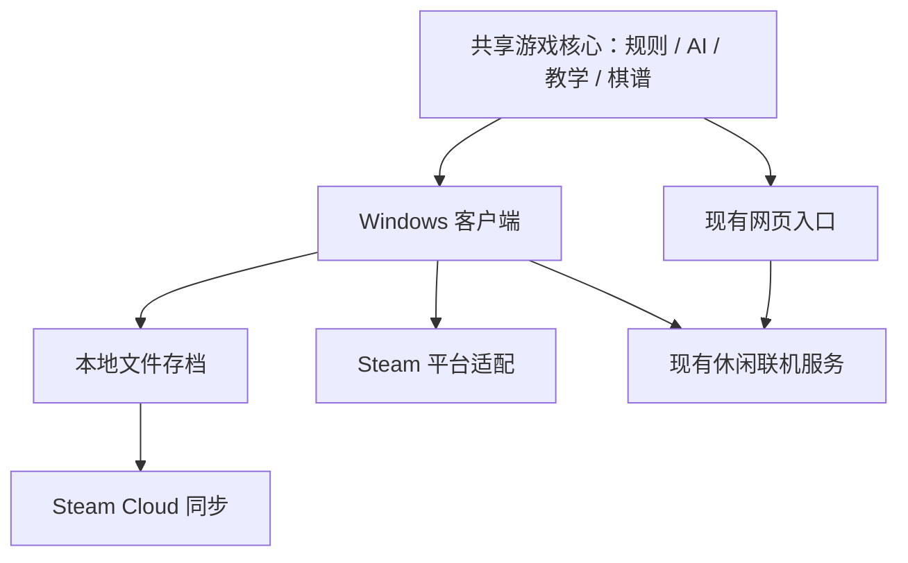

# LIFELINE：从 Web 版到 Steam Windows 买断版

日期：2026-10-13（Asia/Shanghai）  
状态：`PLAN / NOT-IMPLEMENTED`。本次核对了仓库、现有发布记录和官方文档；未执行桌面打包、Steam 接入或发售操作。  
已确认方向：用户选择 **Windows 买断制**。  
推荐路线：**复用 Vue / Canvas / JavaScript 游戏核心，以 Electron 构建桌面客户端；先交付完整离线体验，再接入 Steam 和现有休闲联机。**

## 1. 目标、范围与时间假设

让玩家从 Steam 安装后，能直接学习规则、挑战 AI、完成有目标的单人内容、保存和复盘对局，并在再次启动或更换电脑时继续进度。

首发定位建议：小体量、可反复游玩的原创抽象策略棋盘游戏。核心卖点是三角网格上的扩张、切断与圈地，以及复盘中能看懂的一步逆转。AI 是对手和学习工具，模型数量本身不作为主要销售理由。

- 平台：Windows x64，优先验收 Windows 11；是否列出 Windows 10，待选定运行时、Steam 客户端与实机测试后确定。
- 操作：首发键鼠，完整支持窗口/无边框全屏和缩放；手柄、Steam Deck、macOS/Linux 后续独立验收。
- 语言：简体中文与英文，沿用现有双语基础。
- 商业：一次购买；暂不设计内购、订阅、赛季通行证。
- 网页：建议继续保留现有游玩和传播入口。Steam 的购买价值来自完整单人挑战、离线安装、进度、云存档与桌面体验；不要先削减网页既有功能来制造差异。
- 发行范围：本计划以国际 Steam 为目标。Steam China / 蒸汽平台有单独流程，不能据此计划认定已满足其发行条件。[Steam China 官方说明](https://partner.steamgames.com/doc/store/china)

时间估算以 **1 名主开发者每周投入约 30–40 小时，必要的美术/音效可少量外协** 为假设：1–2 周得到首个可玩的桌面包，8–12 周形成可送审的发售候选。这约对应 240–480 小时的主开发投入；每周只能投入约 10–15 小时时，粗略工时换算为 16–48 周，应在 M1 后按实际速度重排。以上是项目估算，账户审核、返工和测试反馈可能延长日历时间，尚未承诺发售日。

## 2. 当前可以复用什么

本表区分当前源码、已保存的历史验收和待开发能力。没有把历史 Web 通过记录当成 Steam 通过记录。

| 能力 | 本次查看到的依据 | Steam 迁移处理 |
| --- | --- | --- |
| 三角棋盘、扩张/切断、领土与终局 | `GameEngine.js`、README、规则回归入口 | 继续以 Web `territory-v2` 为产品规则真源 |
| Vue 界面、Canvas、输入与中英文 | `OnlineApp.js`、`Renderer.js`、`OnlineAppI18n.js` | 复用，逐步增加桌面菜单、设置和游戏反馈 |
| 人机、本地人人、双方独立配置、AI 互战 | `LocalAIModes.js`、`LocalPlayerSetup.js`、2026-10-13 本地验收记录 | 作为自由对局基础；简化普通玩家看到的 AI 选项 |
| 教学 | `TutorialRunner.js`、现有五关教学与验收记录 | 先改善完整首局，再扩展挑战内容 |
| 保存和复盘 | `LocalGameSession.js`、`ReplayCodec.js` | 复用版本化内容；新增桌面文件存档和迁移机制 |
| 搜索 AI 和研究模型 | `AIEngine.js`、`AIWorker.js`、`ResearchAI.js` 等 | 首发精选稳定对手；研究模型进入高级入口需保留适用范围 |
| 账号、房间、重连 | `NetworkManager.js`、`OnlineRoomSync.js`、Python `server.py` | 复用休闲房间；接 Steam 身份、版本协商和真实网络验收 |
| 匿名棋谱贡献 | `TrainingContribution.js`、接收端与相关测试 | 桌面版建议独立采用明确选择加入；不与购买或离线游玩绑定 |
| 完整网页发布记录 | `WEB_FULL_FEATURES_RELEASE_20261013.md` 记录冻结候选发布及资源核验 | 可作为选定基线的证据；本次未再次核验线上活版本 |

已经识别的具体缺口：

1. `main.js` 当前通过 CDN 获取 Vue，`index.html` 通过 CDN 获取 MathJax。真正离线版需要把依赖和必需资源随包提供。
2. 本地对局主要存于 `localStorage`，尚不是独立、可迁移、有备份的桌面存档。不能把 Chromium 整个用户目录当 Steam 云存档。
3. 网络地址由页面 location 推断，桌面本地地址需要独立的联网配置和离线分支。
4. `server.py` 的 `forward_move` 校验坐标形式与房间归属后转发动作；它没有完整执行 Web 规则来裁决合法步与胜负。公开竞技排名需要补服务端权威规则执行。
5. 研究模型已有 Web 兼容性记录，但 `WEB_SIZE_TRANSFER_V1_20261012.md` 仍记录训练实现与 Web 的计分差异、棋力评估未完成。桌面产品不以增加训练任务作为首发前提。
6. 本次定向检索未找到现成 Electron/Tauri/Steam 构建入口，需要新增桌面工程与发布流水线。

当前工作区分支为 `codex/territory-v2-page-correctness`，HEAD 为 `0c1b5fda188e038b34b2c192e2f03932fb1169d0`，含大量未提交和未跟踪功能。**该 HEAD 单独不能代表当前完整游戏。** 正式实施时先选定包含所需新功能的冻结候选，明确记录源码和资源清单；避免从远端旧版本开工而漏掉近期成果。

## 3. 技术路线与第一道决策门

| 路线 | 与当前项目的关系 | 建议 |
| --- | --- | --- |
| Electron + 现有 Web 核心 | 复用 JS、Canvas、Vue 和 Worker；随包提供浏览器运行时 | **优先做原型**；代价是安装体积、内存和运行时维护，均要实测 |
| Tauri + 现有 Web 核心 | 同样有复用机会，但需验证 WebView、Worker、打包与 Steam 原生桥接组合 | 只有明确的体积/资源目标或 Electron 阻断问题时，再做限时比较 |
| Godot / Unity 重写客户端 | 需要重新实现或重新桥接界面、输入、规则和 AI，并重新验证一致性 | 当前首发不采用；当产品明确转向重 3D 或主机平台时再单独立项 |

首轮原型最多先投入约 5–8 个开发日，解决以下问题后再确认生产技术栈：

- 发行包在没有开发环境的 Windows 机器上启动，断网后完成一局、查看规则、复盘。
- 模块 Worker、模型文件读取和哈希校验在安装目录、中文路径与打包模式下正常工作。
- 全屏、Alt-Tab、高 DPI、窗口大小变化和 Steam Overlay 不破坏棋盘输入或 AI 调度。
- Steam 原生桥接能在最终打包形式中初始化，且获得可验证的身份/成就调用结果。
- 记录包体、启动时间、空闲/对局内存、AI 等待时间，再决定支持设备和资源预算。

`steamworks.js` 是可评估的第三方桥接候选，它明确支持 Electron；它不是 Valve 官方 JavaScript SDK，也不能仅凭 README 推断当前运行时全部兼容。固定 Electron、桥接和 SDK 版本，在真实安装包中测试。其示例要求向渲染层开放 Node 能力，**本项目应改为主进程持有 Steam 接口、通过受限桥接暴露必要功能**，保持页面隔离和沙盒；不得为了让示例运行而扩大页面权限。[桥接项目](https://github.com/ceifa/steamworks.js) · [Electron 安全建议](https://www.electronjs.org/docs/latest/tutorial/security/)

如果原型无法稳定运行，先判断问题属于打包、Overlay、桥接还是渲染性能，再给对应问题安排 2–3 天限时验证。原型未过门时不同时重写内容和更换引擎。

### 建议的代码边界

先新增 `desktop/` 工程与小型 `PlatformAdapter`，提供存档、文件选择、Steam 功能、外部链接与联网配置等能力。最初可以在构建时直接复用 `web/web前端/`，无需先完成大范围目录重构。只有出现明确复用压力时，再抽出 `packages/game-core/`、`packages/game-ui/`；不维护两份不同规则引擎。

桌面单机不依赖 Python 后端，不要求玩家安装 Python/Node。Python 服务继续负责远程休闲联机与可选棋谱接收。

## 4. 首发产品清单

### 必须交付：完整买断体验

| 模块 | 建议首发范围 | 可观察的验收结果 |
| --- | --- | --- |
| 首次启动 | 语言、简洁主菜单、开始教学/自由对局/继续游戏 | 不注册账号也能完成首局；初次断网启动可用 |
| 教学 | 现有五关，强化切断、断联与计分反馈 | 玩家能解释一次切断和本局输赢原因 |
| 单人挑战 | 建议 24–36 关，分为连接、切断、圈地、综合四组 | 每关有目标、已验证解法、失败反馈与重试；进度可保存 |
| 自由对局 | 人类对 AI、本地双人；保留已稳定的三人和 AI 互战入口 | 所有公开设置组合有明确支持范围；不暴露不兼容模型 |
| AI 难度 | 先做 3 个易理解的难度档，底层可沿用搜索 AI | 在发布棋盘尺寸上测响应与人类体验；未测模型不标为更强 |
| 保存与复盘 | 自动续局、手动保存、棋谱导入/导出、逐步重放 | 强制关闭后恢复最近已确认行动；旧棋谱升级可验证 |
| 桌面体验 | 窗口/全屏、音量、分辨率适配、缩放、快捷键、清楚的退出流程 | 窗口变化不误点；返回主菜单/退出不丢进度 |
| 视听 | 落子、连接、切断、失联清除、圈地与胜负的动画/音效 | 玩家能从反馈理解结果；可降低动态效果、调低或关闭音效 |
| Steam 能力 | 从库启动、成就、云存档、更新；Overlay 实测 | 使用自有 AppID、真实 Steam 客户端和两台设备验证 |
| 双语和可读性 | 教学、错误提示、菜单、挑战和商店一致 | 不依赖颜色单独区分玩家；1280×720 与高 DPI 均可操作 |

关卡数量是生产预算，最终以质量决定。建议先做 6 个代表性关卡验证可玩性，再扩展到完整章节；关卡初态、规则版本、动作目标与参考解保存在版本化数据文件中。限步目标、存活目标、圈地目标分别验证，避免把 AI 评估分数直接当成通关裁定。

成就建议先做约 10–15 项，例如完成教学、首次有效切断、完成某组挑战、不同难度获胜。解锁条件以真实游戏事件为准；重复回放不重复计数，测试构建与正式数据隔离。

### 首发争取包含：现有休闲联机

保留房间码约战与重连，优先解决 Steam 账号进入、客户端版本/规则版本协商、超时退出和重新对局。首发是否开放 Web 与 Steam 互通，取决于双方对相同动作序列、状态与终局结果的端到端验收。

建议在第 5 周作一次明确决定：联机稳定则随 1.0 提供；若仍有断线丢局或状态分叉，则将 1.0 定位为完整单人/本地游戏，更新商店承诺并将联机安排到后续版本。不能展示多人功能标签却交付不可用入口。

### 放到后续版本

公开排位与 Elo、全球匹配、观战赛事、创意工坊、复杂关卡编辑器、Steam 好友邀请深度集成、完整手柄与 Deck 验证、其他操作系统，以及新的大规模 AI 训练。

理由分别是服务端裁决和运营成本、玩家数量要求、内容审核与额外平台验证；它们不应挤占首发的离线、存档和教学质量。

## 5. 必须提前处理的工程细节

### 离线与构建

- 固定依赖版本和锁文件；Vue、MathJax、字体、指南、音效和选入首发的模型都随包提供，核对再分发授权。
- 处理目前带缓存版本参数的模块导入、相对资源 URL 和 Worker 路径。使用一致的本地资源协议或打包方案，验证 `fetch`、模块加载、Web Crypto 与 Worker 的实际行为。
- 当前页面存在运行时 Vue 模板，离线打包时同时评估模板预编译和内容安全策略，不能只收紧策略却让界面无法加载。
- 按发布清单收集资源，不把整个仓库塞进安装包。模型只分发已选定的推理资源与来源信息，不分发训练检查点、原始棋谱、数据库或开发机配置。
- Steam 版更新由 Steam 构建发布管理；不再叠加一套会与 Steam 互相覆盖的自动更新器。

### 存档与 Steam Cloud

- 在系统用户数据目录下按用户保存：进度、当前对局、收藏棋谱与本机设置分开。存档包含 schema、规则版本、游戏构建和必要历史信息。
- 原子写入、上一份可读备份、读取校验和版本迁移；较新存档不能被旧客户端静默覆盖。回退游戏版本前测试存档兼容或提示恢复备份。
- 继续保留完整 Superko 历史与跳过/认输/终局状态，或从合法行动序列完整重建并验证；不能只保存棋盘占用。
- Steam 用户之间、游客与 Steam 用户之间的数据隔离，账号切换不串档。导入网页棋谱通过显式文件操作完成，不假设桌面能读取浏览器的 localStorage。
- 优先评估 Steam Auto-Cloud 同步小型进度/存档文件；排除日志、上传队列、认证信息、显卡/分辨率配置和全部缓存。两机离线分叉时保留双方版本，并测试 Steam 的冲突选择流程。

Steam 提供 Cloud API 与 Auto-Cloud 两种方案；Auto-Cloud 可对指定文件在启动/退出前后进行同步，但不会替游戏设计好存档格式、用户隔离和冲突恢复。[Steam Cloud 官方文档](https://partner.steamgames.com/doc/features/cloud)

### 联机、身份与数据贡献

- 桌面使用 Steam 会话票据交由后端验证，后端将验证后的身份映射到已有账号/房间服务。客户端自报 SteamID 不作为认证。已有网页账号绑定需用户明确选择，不能凭昵称自动合并。[Steam 身份认证文档](https://partner.steamgames.com/doc/features/auth)
- 现有休闲服务增加协议版本、规则版本和兼容范围；不兼容时明确拒绝入房。补动作编号、重复消息处理、超时/重连与状态摘要核对。
- 首发保留 WSS 客户端/服务器路线；Steam 登录、Steam Lobby 和 Steam Networking 是不同能力，不因接入 SDK 就同时替换全部网络系统。
- 排位若立项，服务端需要执行权威 `territory-v2` 规则、记录可重放动作和结果。可评估复用 JS 核心的服务端执行单元；不能直接用旧 Python 研究实现替代。
- 当前 Web 棋谱贡献代码默认开启。桌面版建议调整为明确选择加入，并说明内容和用途；不同意时完整单机照常可用，Steam 身份不进入匿名棋谱。该项是桌面产品建议，本次未更改网页行为。

## 6. 分阶段计划与退出标准

以下周次从真正启动实施开始计算，可以重叠。账户/商店事务与开发并行推进。

| 阶段 | 时间窗口 | 主要工作与交付物 | 进入下一阶段的条件 |
| --- | --- | --- | --- |
| M0：冻结范围 | 第 1 周，约 2–3 天 | 选定现有功能基线；列首发清单；确认标题、发行主体、投入时间；梳理素材授权；建立 Steam 任务清单 | 有可复现候选与范围表，知道现有未提交成果如何保留 |
| M1：桌面完整首局 | 第 1–2 周 | Electron 原型；离线依赖；Worker/模型；初版文件存档；Steam 桥接试验；Windows 包 | 新机器安装→断网教学→AI 完整一局→退出→恢复→复盘通过 |
| M2：可购买的内容 | 第 3–5 周 | 主菜单、设置、视听反馈；先 6 关再 24–36 关；精选 AI 难度；保存/导出；双语 | 8–12 名新人中至少 80% 无口头引导完成教学与首局；关键理解问题已修正 |
| M3：Steam 与联机 | 第 4–7 周 | 自有 AppID 测试；成就/Cloud/Overlay；SteamPipe；休闲身份/协议兼容；第 5 周确认联机首发范围 | 两机云存档、账号切换和升级测试通过；首发范围已冻结 |
| M4：玩家测试与商店 | 第 6–9 周 | Playtest 或封闭 Beta；可选 Demo；商店截图、胶囊图、预告片、双语说明；修复反馈 | 约 20–30 名测试者；发布候选没有未解决的阻断问题；宣传只展示实际交付能力 |
| M5：送审与发布 | 第 9–12 周 | 干净安装回归；存档升级/回滚演练；近最终构建送审；安排发布与首周支持 | 平台放行、时间限制满足、全部发布必需门通过，再由发行者确认正式发售 |

M2 的人数和比例是内部可用性目标，不是 Steam 的硬性要求，也不是统计学上的市场成功证明。挑战内容、云存档等目标未完成时延长阶段，不把完成某个周次当成通过。

建议保留 1–2 周返工/审核余量。Steam 账号材料由用户提供与确认；原型在等待账户时可继续做离线和本地文件能力。开发测试 AppID 只能证明部分技术链路，自有 AppID 的身份、成就、云存档和发布配置必须另行验收。

## 7. Steam 上架与获客并行推进

### 第 1 周启动发行准备

建立 Steamworks 发行主体，准备身份、银行和税务资料，完成协议与应用费用。可以个人身份入驻；主体、收款与税务信息应按实际材料填写。最终标题先做同名产品与品牌检索，再制作胶囊图，避免完成美术后改名。[Onboarding](https://partner.steamgames.com/doc/gettingstarted/onboarding?language=english)

截至本次核对，Steam Direct 每个应用费用为 **100 美元或等值金额**，可能另有适用税费；达到 **1,000 美元 Adjusted Gross Revenue** 后按官方规则在结算中回收该费用，并非随时可退押金。[Steam Direct Fee](https://partner.steamgames.com/doc/gettingstarted/appfee?language=english)

**时间信息存在公开页面差异：** 本次读取的 [Steam Direct 介绍](https://partner.steamgames.com/steamdirect/?l=english) 写缴费后 30 天等待，而 [Onboarding 英文页](https://partner.steamgames.com/doc/gettingstarted/onboarding?language=english) 返回 21 天。计划暂按较保守的 **30 天** 留余量；实际最早发售资格以 Steamworks 后台当时显示及 Valve 确认为准。两页都要求 Coming Soon 公开至少两周。这里不把 21 天作为确定的新规则。

### 第 3–5 周准备 Coming Soon

商店核心表达建议围绕“在三角网格上连成领土，一次切断改变战局”。展示真实操作：扩张形成连接→对手切断→连锁清除→局势反转→复盘解释。

准备中英文短描述、完整说明、真实游戏截图、商店/库图像、约 45–75 秒实机预告片、系统需求初稿与联系支持方式。预告片长度是本项目建议。所有图像规格按提交时官方模板制作；已确认体验之前不要勾选多人、手柄、Deck 或云存档等标签。

### 第 6 周起测试与传播

先邀请约 20–30 名目标玩家，通过同意后的简短反馈或本地测试记录了解：教学卡点、首局耗时、愿不愿意再来一局、最想保留的模式、对价格和内容量的判断。玩家来源优先是抽象棋类、围棋/Hex、策略解谜爱好者。

Steam Playtest 适合测试功能和稳定性，使用关联的独立 AppID；Demo 用于公开展示经过打磨的一部分体验，建议为教学、6 个精选挑战和受限自由对局。测试进度和正式进度分开，Demo 到正式版只做已验证的迁移。不要用付费抢先体验代替本应完成的首发质量。[Steam Playtest](https://partner.steamgames.com/doc/features/playtest)

网页可以增加 Steam 愿望单入口和短演示，保留现有玩家的直接反馈渠道。是否参加新品节，等可用 Demo 和实际官方报名窗口明确后再决定；不为了活动日期压缩存档与离线验收。

### 送审和发售

商店页面与游戏构建分别需要审核。官方文档给出的通常周期为 3–5 个工作日，并建议各自至少预留 7 个工作日。按后台要求完成内容问卷、发行地区必填项和商店检查清单；先上线合格的 Coming Soon，再用近最终构建送审。商店通过、构建通过和公开发售是不同步骤。[Review Process](https://partner.steamgames.com/doc/store/review_process?language=english)

预计最早发售时间取以下条件中最晚满足者：项目质量门通过、账户/付费等待限制满足、Coming Soon 满两周、商店与构建均通过审核。上线首周预留故障处理时间，准备旧构建回退与存档恢复说明。

## 8. 成本与定价假设

| 项目 | 计划方式 |
| --- | --- |
| Steam Direct | 官方应用费 100 美元；适用税费另算 |
| 开发投入 | 1 名主开发者约 8–12 周，时间是主要成本；不折算成虚构报价 |
| 美术、胶囊图、音效、预告片 | 可先为外协预留约人民币 3,000–10,000 元；这是内部预算假设，需具体报价，自己制作可降低现金支出 |
| 联机服务 | 先核对现有服务器实际账单、并发与可用区域，再估增量；离线首发不依赖新增推理服务器 |
| 代码签名、专业翻译等 | 需要时单独询价，不把未知价格当固定成本 |
| 训练与研究 | 不列入首发必要预算；新长任务需按仓库要求另设预算、检查点与自动恢复验证 |

初步可以用国区 **18–32 元** 作为买断价的用户测试区间。这是待验证的定价建议，不是收入预测或 Steam 推荐定价；最终价格取决于完成的内容、同类产品比较、实际反馈和 Steamworks 可选价格档，其他地区按后台区域定价方案审阅。

若测试结果显示用户只需要偶尔打开自由对局，应先增强挑战、复盘学习和桌面体验的价值，再决定价格与发行时机。不要靠大量 AI 名称、未经验证的强度宣传或承诺未来更新支撑首发售价。

## 9. 发售验收门

以下是本项目建议门槛，需在 M0/M1 校准设备与范围后冻结，不是本次已通过结果。

| 门 | 必须拿到的证据 |
| --- | --- |
| 规则一致 | 网页与桌面运行同版核心；固定棋谱覆盖切断、Superko、连续跳过、认输、终局；逐步状态和比分一致 |
| 离线可用 | 新装用户、清空运行缓存、断网，教学/挑战/AI/指南/存档/复盘均可用；不等待 CDN 或网站健康 |
| 数据不丢 | 强制退出、异常文件、满盘/写入失败、旧版本升级、Steam 账号切换、两机离线分叉有明确结果与恢复路径 |
| AI 可控 | 小/中/大支持棋盘和不同阶段局面都有响应记录；取消/重开拒绝旧结果；失效时可见重试或降级 |
| 桌面操作 | 至少在两台配置不同的真实 Windows 电脑测试；覆盖 1280×720、1080p、高 DPI、全屏、Alt-Tab、睡眠唤醒 |
| Steam 功能 | 自有 AppID 下库启动、Overlay、成就、Cloud、更新经过真实客户端检查；测试构建与正式构建不串数据 |
| 联机条件门 | 若首发宣传联机，必须两名真实玩家完成入房→完整对局→断线恢复→重赛；Web 互通需另有两端证据 |
| 内容与理解 | 所有挑战存在已验证解法；无阻断关卡；新人测试记录原始人数、完成率和修复复测结果 |
| 发布质量 | 无已知启动失败、错误胜负、必现卡死、存档损坏、账号串档；商店功能与构建一致 |
| 可恢复发布 | 保存候选构建/源码/资源哈希、依赖锁、测试命令、发布收据；回滚不静默破坏新存档 |

性能先在 M1 选定普通集显笔记本作基准，建议测量目标为冷启动进入菜单不超过约 5 秒、落子可见反馈通常在约 100 毫秒内、普通 AI 档位大部分局面在约 2 秒内响应。高难度可以更慢，但必须显示思考并允许取消。上述是候选体验预算，先测固定局面集的分布再冻结，不能靠平均值遮住长时间卡顿。

自动回归优先复用 `verify-territory-v2.mjs`、`verify-local-game-session.mjs`、`verify-replay-codec.mjs`、`verify-local-ai-session.mjs`、`verify-tutorial.mjs`、`verify-online-recovery.mjs` 等现有入口。新增测试集中在平台存档、原生桥接和打包后的完整路径；Node 测试不能替代发行包、Steam 客户端与真实设备验证。

## 10. 第一周可以直接执行的任务

1. **选定基线**：比较当前工作区与现有冻结发布候选，列出要带入桌面的功能和资源；在合适的 `codex/` 开发分支保护现有改动。
2. **建最小桌面工程**：本地加载现有界面，固定依赖，接通真实 Canvas 与 Worker，先让一局从开始到终局跑完。
3. **切断线上依赖**：随包提供 Vue/指南/首选 AI，断网检查实际请求，明确联网入口只在用户进入相关功能时启用。
4. **做存档垂直流程**：保存当前对局到文件，强制关闭后重新启动恢复，用同一棋谱核对状态与结果。
5. **验证 Steam 桥接与资源预算**：测安装包中的初始化、Overlay/输入、包体/内存/启动时间；列出需自有 AppID 才能完成的后续项。
6. **并行做发行资料和六关样板**：用户确认主体和实际预算；开发者准备标题/商店草稿、素材清单与六个代表关卡。

第一周的交付是可检查的 Windows 原型、基线/资源清单和原型验证记录。只有完成“安装→断网完整一局→关闭→恢复→复盘”，才能把“桌面可玩版”标为通过；接下来才扩充关卡和发售内容。

## 11. 本次依据与状态边界

- 当前仓库：已读 `AGENTS.md`、README、Web 入口、保存/贡献/网络模块、后端动作转发，以及现有发布门。
- 产品记录：[Web 完整功能发布](../releases/WEB_FULL_FEATURES_RELEASE_20261013.md)、[本地双方配置](../releases/LOCAL_PLAYER_SETUP_20261013.md)、[复盘与 AI 贡献整合](../releases/REPLAY_AI_CONTRIBUTION_INTEGRATION_20261013.md)。它们描述各自冻结候选，本次没有重新签署通过状态。
- AI 边界：[尺寸迁移 Web 记录](../releases/WEB_SIZE_TRANSFER_V1_20261012.md)。历史研究模型验证不等于本计划的产品棋力验收。
- Web 发布基线：[LIFELINE 发布门](../product/LIFELINE_RELEASE_GATE.md)。Steam 版应追加桌面专属矩阵，保留原历史文档。
- 外部来源：本文相关段落所链 Steamworks 官方文档、Electron 官方文档和第三方桥接源码；核对日期为 2026-10-13。
- 本次产物仅为计划文档；Steam 工程、付费、账户变更、商店发布、用户招募和线上部署均未执行。
