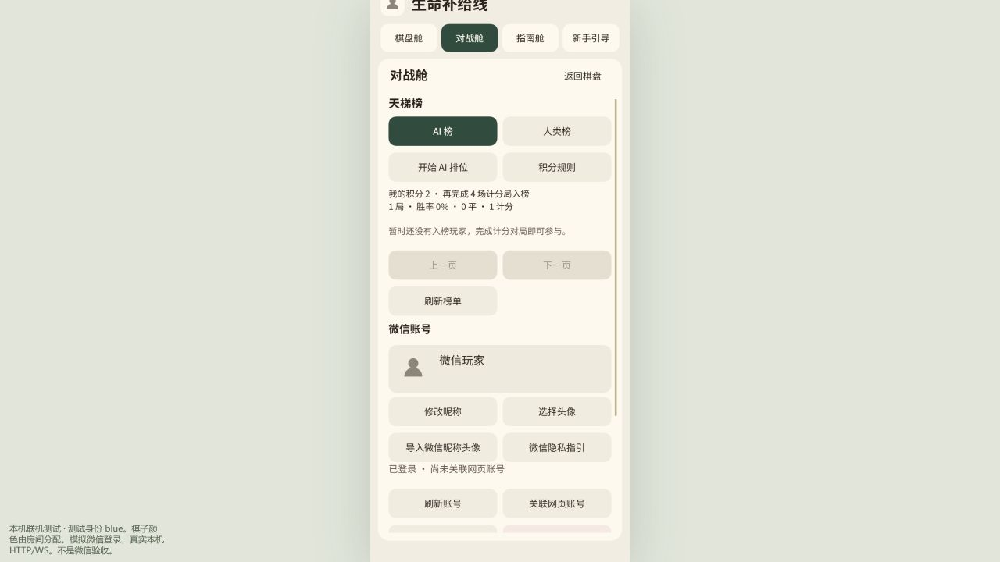
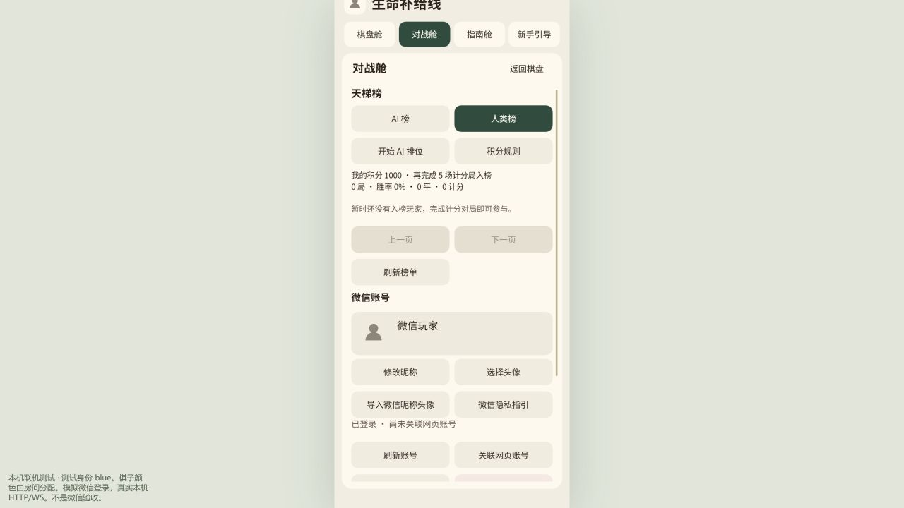

# 微信对战舱天梯：2026-10-26 本地交付

状态：`IMPLEMENTED_AND_SELF_CHECKED_LOCAL`。AI 榜、人类榜、服务端计分、结算反馈、分页、自己的成绩及中英双语规则已实现。评分定义见 [产品规则](../product/WECHAT_LADDER_V1.md)。本记录是实现者自测，不是独立审查或微信真机验收。

## 使用与范围

在对战舱点“AI 榜”或“人类榜”查看；满 5 场计分局入榜，同分并列。AI 排位由“开始 AI 排位”选择四档难度，服务器实际执行 AI 并结算。本地人机、教学、导入棋谱不计分。人类榜接入此工程现有微信/网页共享双人房间；没有改造其他多人房间服务。

AI 积分同时考虑难度、成绩和有限的场次奖励。人类积分使用 K=16 的 Elo 加有限场次奖励；击败强者收益更高，明显的长期优势不会因一次失误消失。小分差仍可能换位。每日限额、开局 PASS 不计分及服务端去重提供基本防刷约束，不代表能够识别串通或外部辅助。

## 回归检查

以下命令从本平台 checkout 执行。Python 使用本工程 `.venv/Scripts/python.exe`；Node 命令从 `wechat/minigame` 执行。测试均使用合成账号、临时 SQLite 或本机 fixture，没有读取生产账号、棋谱或数据库。

最后一轮客户端：**55/55 通过**，包含本次新增的跨榜结算反馈隔离与返回对战舱刷新回归。

```text
node --test --test-concurrency=4 tests/ladder.test.mjs tests/service-package.test.mjs tests/online-navigation.test.mjs tests/help-result.test.mjs tests/online-consent.test.mjs tests/cabins-ui.test.mjs
```

最后一轮后端：**56/56 通过**，包括四档真实 Node AI 回应、真实引擎平局、计分公式/限额/北京时间边界、排名隐私、重复提交和重启去重、事务冲突与 AI 失败回滚、到期结算、账号关联/删除、备份恢复、schema 3 升级及 schema 3/4 只读预检。

```text
.\.venv\Scripts\python.exe -m pytest web/tests/test_wechat_ladder.py web/tests/test_wechat_service_preflight.py web/tests/test_wechat_profile_preflight.py -q
```

此前受影响范围的回归：客户端 **98/98**；后端 **97 通过、1 项排除**；随后又通过天梯、资料恢复及 socket 生命周期组 **25/25**。这些组存在重叠，不能相加当作独立测试数量。

```text
node --test --test-concurrency=4 --test-timeout=180000 tests/ladder.test.mjs tests/cabins-ui.test.mjs tests/online-consent.test.mjs tests/online-navigation.test.mjs tests/identity-client.test.mjs tests/help-result.test.mjs tests/ui-overlap.test.mjs tests/network-recovery.test.mjs tests/service-package.test.mjs tests/profile-0110.test.mjs tests/return-to-board.test.mjs tests/project-package.test.mjs tests/testcloud-unicode-compat.test.mjs

.\.venv\Scripts\python.exe -m pytest web/tests/test_wechat_ladder.py web/tests/test_wechat_online.py web/tests/test_wechat_accounts.py web/tests/test_wechat_profiles.py web/tests/test_wechat_service_recovery.py web/tests/test_wechat_configuration.py -q -k "not actual_legacy_login_bridges_only_existing_unexpired_web_accounts"

.\.venv\Scripts\python.exe -m pytest web/tests/test_wechat_ladder.py web/tests/test_wechat_profile_recovery.py web/tests/test_wechat_socket_lifecycle.py -q
```

排除项为已实际失败的 `test_actual_legacy_login_bridges_only_existing_unexpired_web_accounts`：旧 `web/web后端/server.py` 的 `/api/wechat/login/web` 返回 405，该旧入口没有挂载微信 router。本任务未修改该文件；微信独立服务的登录、身份、计分测试通过。不能因此声称整个仓库测试全绿。

## 真实本机交互

启动 `node tools/preview.mjs --online-fixture`，使用 `http://127.0.0.1:8791/?player=blue` 的合成微信身份，真实本机 HTTP/WS 与 SQLite。已走通：

1. 打开对战舱，切换 AI / 人类榜，读取空榜和自己的成绩。
2. 选择普通 AI 排位，玩家落子 `[1,0]` 后，服务器 AI 实际回应并轮回玩家。
3. 认输后读取结算详情，AI 场次奖励 +2；AI 榜显示 1 局、0% 胜率、2 分、距资格还差 4 局。
4. 重新构建预览并刷新页面，重新登录后成绩仍在；人类榜保持 0 局、1000 分，未混入 AI 成绩。
5. 最终浏览器警告/错误记录为空。保存以下截图后关闭临时预览。





## 构建及候选

- 默认离线编译检查：`buildGame()` 成功，33 个运行文件、113 个源码输入、总计 **19,807,199 bytes**，主包 **1,653,383 bytes**。默认 `dist` 的联机配置仍关闭，此检查证明编译和包体通过。
- 独立在线客户端候选：`local_artifacts/wechat-ladder-client-20261026/0.12.5-55f0eb348e69-muo2vc/project`。配置为现有公开服务源 `https://lifelinegame.cn`，独立重建逐字节一致；35 个包文件，**19,807,244 bytes**，主包 **1,653,428 bytes**。生成过程不访问远端。候选沿用工程已有 0.12.5 元数据及旧通用上传说明，尚未选定新的渠道发布版本；本次内容和验收以本记录及源码哈希为准，不能将其直接当作已批准上传的发布包。
- 配套微信独立服务候选：`local_artifacts/wechat-ladder-service-20261026-r1/`，59 文件、**633,123 bytes**，`ladder-v1` / schema 4，状态 `PREPARED_LOCAL_NOT_DEPLOYED`。`node tools/prepare-service.mjs --verify '../../local_artifacts/wechat-ladder-service-20261026-r1' --check-sources` 通过。
- [构建、依赖及本次源文件哈希](wechat-ladder-20261026/receipt.json) 保存确切快照。生成的大包、原始日志和测试数据库留在本地，未纳入 Git。

在线客户端候选的生成命令（输出必须为新目录，不能覆盖冻结候选）：

```text
node --input-type=module -e "import path from 'node:path'; import { prepareCandidate } from './tools/prepare-candidate.mjs'; await prepareCandidate({outputBase:path.resolve('../../local_artifacts/wechat-ladder-client-20261026'), online:true, apiBase:'https://lifelinegame.cn'});"
```

## 数据与发布边界

数据库增量迁移到 schema 4；旧数据与旧规则对局不回填积分。终局、积分和去重记录同一事务提交，恢复工具保留最新天梯及账号删除状态。原有 schema 3 服务不能直接回滚到已升级数据库；部署前需要停写备份及支持 schema 4 的回滚代码。没有改写此前冻结的激活脚本。

实际工作目录为 `C:/Users/zcz/.codex/worktrees/wechat-minigame/line game`，分支 `codex/wechat-minigame`，任务前 HEAD `f289015`。主目录的 `wechat/project` 是本工程入口。此 checkout 原已存在大量未提交及未跟踪的平台代码；本次仅把触及的任务文件纳入提交，保留其他工作。候选哈希覆盖实际依赖，但本提交本身不代表从干净 HEAD 能复现整个既有平台。

未推送、未连接生产服务器、未部署、未上传微信、未真机验收、未提审、未公开发布。天梯正式可用需要本次客户端与配套服务同时发布。
